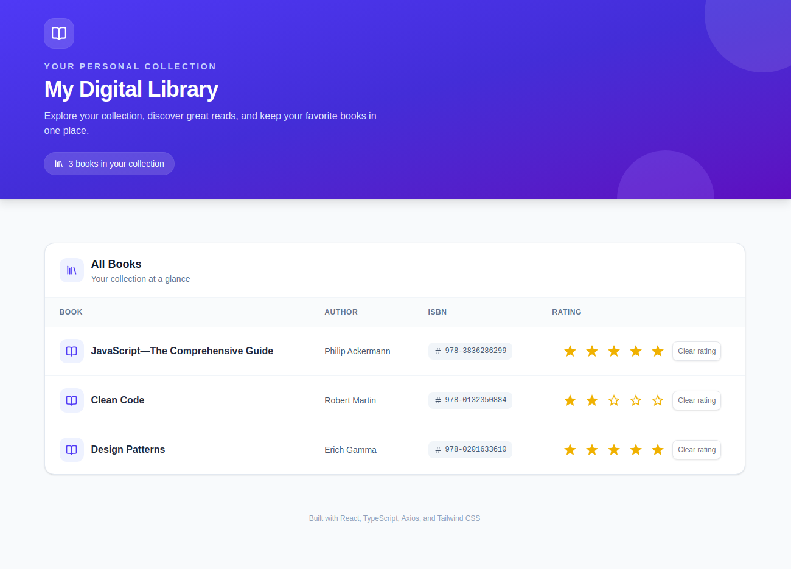

# React Data Fetching with Axios

A practical React example demonstrating data fetching with Axios.

This example is part of the **[React The Comprehensive Guide](https://github.com/beasiteri/react-the-comprehensive-guide)** project, which provides an overview of the topics and links to the individual implementations.

## Example

The project demonstrates how to fetch and display data from a REST API using Axios in a React application.

It covers:

- Fetching data with Axios
- Managing fetched data with React state
- Handling loading and error states
- Rendering API data in React components
- Using Mock Service Worker (MSW) to mock API responses

## Tech Stack

- React
- Vite
- TypeScript
- Tailwind CSS
- Material UI
- Axios
- Mock Service Worker (MSW)

## Running Locally

Clone the repository and install the dependencies:

```bash
git clone <repository-url>
cd <repository-name>
npm install
npm run dev
```

The application starts using Vite with MSW providing the mocked API responses.

## Screenshot


